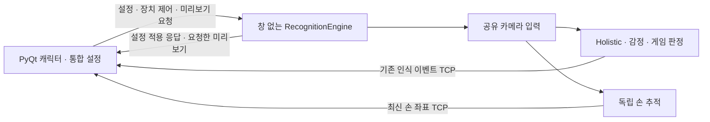

# 통합 사용자 인식

일반 실행 진입점은 `main.py` 하나다. PyQt 앱이 설정·미리보기를 표시하고, `medeapipe_capstone/main.py --background`는 Tkinter 없이 카메라와 모델 추론만 실행한다.

## 구성

- `app/recognition_engine.py`: 기존 인식·감정·게임·STT 로직과 장치 상태를 소유한다. 창이나 위젯을 생성하지 않는다.
- `app/worker_loop.py`: 같은 작업 스레드에서 명령·설정·인식 콜백을 순차 실행한다. 표준 입력 리더는 명령만 큐에 넣는다.
- `app/settings_bridge.py`: 기존 저장·적용 확인 절차와 장치 시작·중지 명령을 처리한다.
- `app/preview_stream.py`: 미리보기를 요청한 동안만 이미지를 준비한다. 최대 640픽셀 너비·5FPS이고 대기 슬롯 하나에서 최신 프레임으로 교체한다.
- 루트 `main.py`의 `MediaPipeProcessManager`: 작업 시작·종료·재연결과 미리보기 수신을 관리한다.
- `character/settings_controller.py`, `settings_dialog.py`: 기존 설정의 사용자 인식 탭에서 영상·상태·옵션을 표시한다.
- `app/holistic_gui_app.py`: 공통 엔진을 이용하는 선택적 개발용 진단 뷰다. 일반 실행에서는 import하지 않는다.

## 미리보기와 종료

사용자 인식 탭에서 미리보기를 켜면 `preview 1`을 보내고, 다른 탭·닫기·최소화 시 `preview 0`을 보낸다. 이 구독은 카메라와 인식 자체의 실행 상태를 바꾸지 않는다. 설정을 닫아도 게임·손 추적·음성 입력은 계속된다.

미리보기는 stdout의 `APP_PREVIEW` 메시지로만 전달하며 부모는 해당 메시지를 로그 수집보다 먼저 분리한다. Qt 쪽도 최신 프레임 하나만 보관하고 100ms 간격으로 확인한다. 픽셀과 인코딩된 카메라 영상은 로그에 쓰지 않는다. 기존 의미 이벤트와 손 좌표 전송 경로는 유지한다.

명시적 종료와 부모 입력 파이프 종료는 같은 정리 경로를 사용한다. 카메라 읽기와 손 추적이 끝나기 전에 자원을 해제하지 않는다. 작업이 비정상 종료되면 1·2·4초 간격으로 최대 세 번 연속 재시도한다. 실제 인식 성능 요약이 도착하면 정상 동작으로 간주한다. 앱 종료 시에는 재시작을 취소하고, Windows의 강제 정리가 필요하면 가상환경 실행기의 자식 프로세스까지 함께 종료한다.

시작할 때는 저장된 카메라를 우선 열고, 장치 새로고침에서 전체 목록을 다시 검색한다. 모델 복잡도·해상도·판정 임계값은 이 구조 변경에서 바꾸지 않는다. `CAPSTONE_HOLISTIC_COMPLEXITY=1`은 앞서 추가한 별도 경량 시험 옵션이다.

## 검증

로컬 테스트는 부모 EOF, 창 없는 생성, 미리보기 비활성 시 인코딩 없음, 최신 프레임 교체, 탭·창 닫기 시 구독 해제, 게임·손 추적·설정 저장·적용, 제한된 재시작을 검사한다.

실제 카메라 검사에서는 Qt 미리보기 표시, 탭 이동 시 수신 중단, 작업 강제 종료 후 자동 재연결·표시 재개, 종료 후 남은 작업 없음, Tkinter 미로딩을 확인했다. 검증 결과에는 프레임 개수와 상태만 저장했고 카메라 영상을 저장하지 않았다. 이 확인은 구조·연결 검증이며, CPU 사용량 개선이나 인식 정확도 개선을 의미하지 않는다.
